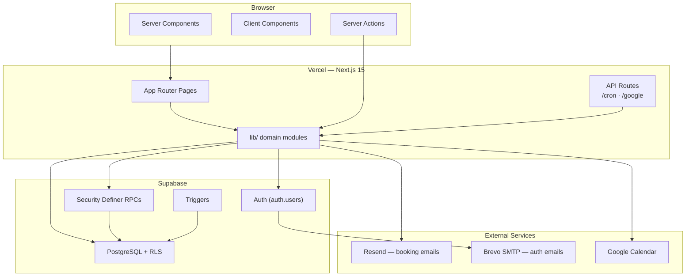

# NailsByGabs — Technical Architecture & Project Write-Up

This document is an in-depth technical overview of **NailsByGabs**, a production web application built for a solo GelX nail artist. It covers product decisions made during development, system architecture, implementation patterns, and the specific engineering challenges encountered feature by feature.

**Production URL:** [https://nailsbygabs.org](https://nailsbygabs.org)  
**Repository stack:** Next.js 15 · React 19 · TypeScript · Supabase · Vercel

---

## Table of Contents

1. [Executive Summary](#1-executive-summary)
2. [How This Project Evolved](#2-how-this-project-evolved)
3. [Owner-Driven Product Decisions](#3-owner-driven-product-decisions)
4. [Product Scope & Design Goals](#4-product-scope--design-goals)
5. [Technology Stack](#5-technology-stack)
6. [High-Level System Architecture](#6-high-level-system-architecture)
7. [Application Structure](#7-application-structure)
8. [Frontend Architecture](#8-frontend-architecture)
9. [Authentication & Authorization](#9-authentication--authorization)
10. [The Booking System](#10-the-booking-system)
11. [Database Design & Evolution](#11-database-design--evolution)
12. [Analytics Subsystem](#12-analytics-subsystem)
13. [Notifications & Scheduled Jobs](#13-notifications--scheduled-jobs)
14. [External Integrations](#14-external-integrations)
15. [Security Model](#15-security-model)
16. [Deployment & Operations](#16-deployment--operations)
17. [Technical Challenges by Feature](#17-technical-challenges-by-feature)
18. [Architectural Tradeoffs](#18-architectural-tradeoffs)
19. [What Is Intentionally Out of Scope](#19-what-is-intentionally-out-of-scope)
20. [Future Directions](#20-future-directions)

---

## 1. Executive Summary

NailsByGabs began as a premium marketing site with a Square booking embed and evolved into a **custom, auth-gated appointment platform** with owner analytics, Google Calendar sync, and automated client emails—without ever adding on-site payments.

The core architectural bet is **simplicity with strong boundaries**:

- **PostgreSQL + Row Level Security (RLS)** as the authoritative business rules engine.
- **Security definer RPCs** for atomic, race-safe booking mutations.
- **Next.js App Router** with Server Components and Server Actions for a mostly server-rendered experience.
- **Optional integrations** (Resend, Google Calendar) that degrade gracefully when credentials are missing.

The site reflects a real small-business constraint: NailsByGabs operates without payment processing on the website. Clients book authenticated time slots; payment happens offline. That single decision eliminated Square, Stripe, deposits, and checkout flows—and shaped every layer of the stack.

---

## 2. How This Project Evolved

Understanding the build order matters because later features were layered onto live booking data, not greenfield schema.

| Phase | What shipped | Trigger |
|-------|--------------|---------|
| **1 — Marketing shell** | Portfolio, services, about, collapsible sidebar, pastel/gold aesthetic | Initial project spec |
| **2 — Square embed** | Booking page with iframe placeholder | Original booking approach |
| **3 — Custom booking** | Supabase auth, slot RPCs, owner/client calendar | Owner rejected Square as overkill; wanted login + calendar only, no payments |
| **4 — Owner tooling** | Manual pre-booked slots, Google Calendar sync, Resend notifications | Real salon workflow needs |
| **5 — Portfolio intelligence** | Filename-based tag sorting (Aura, 3D, Fun…), display title parsing | Owner renamed photos for categorization |
| **6 — Production hardening** | Eastern timezone fix, domain (nailsbygabs.org), email verification via Brevo SMTP | Live client usage exposed bugs |
| **7 — Business intelligence** | Analytics dashboard, event log, backfill, timeframe filters, chart iterations | Owner wanted visibility into bookings/completions/revenue |
| **8 — UX refinement** | Hover-only desktop sidebar, analytics hover tooltips, chart copy cleanup | Portfolio-first layout vs navigation discoverability |
| **9 — Client retention** | 48-hour email reminders via daily cron | Chosen as highest-impact next feature without payments |

Each phase added complexity only where the owner confirmed it was needed—Square was removed rather than extended; analytics was backfilled rather than starting from zero; reminders were email-only rather than SMS.

---

## 3. Owner-Driven Product Decisions

This section documents decisions made explicitly through development prompts—not assumptions baked in by default.

### 3.1 No Square, no payments, custom calendar instead

**Decision:** Remove the Square iframe entirely. Build a lightweight slot calendar where logged-in clients book open times and the owner adds/removes slots.

**Rationale (owner words):** Square was "too much" for the use case. The business is under-the-table; the website must not process payment.

**Architectural consequence:** Supabase auth + Postgres RPCs replaced a third-party booking SaaS. Every later feature (analytics sources, reminders, Google sync) builds on `appointment_slots` rows, not Square webhooks.

### 3.2 Manual pre-booked appointments

**Decision:** The owner can create slots that are already taken, with a **name parameter**, without a client account attached.

**Architectural consequence:** `booked_name` column alongside `booked_by`. Manual slots appear on the owner calendar but not on any client's "my booking" state. Analytics logs them as `booking_source: manual`. Reminder and confirmation emails skip them (no client email exists).

### 3.3 Dual locations: Webster and Binghamton

**Decision:** Appointments are tagged by location. Binghamton bookings require a client acknowledgement ("I attend Binghamton University").

**Architectural consequence:** `location` column, location-colored calendar slots, analytics location splits, and a config-driven acknowledgement dialog (`booking-acknowledgements.ts`) that gates the book action client-side.

### 3.4 Default one-hour appointments

**Decision:** When the owner sets a start time, end time auto-fills to one hour later—still manually overridable.

**Architectural consequence:** Client-side default in the booking dialog; stored as explicit `start_at`/`end_at` in the database.

### 3.5 Eastern Time everywhere

**Decision:** All appointment times display and input in Rochester/Eastern time, regardless of client device timezone.

**Architectural consequence:** `business-timezone.ts` with iterative DST correction. Triggered by a real bug: 4:30 PM Rochester appeared as 12:30 PM after treating `datetime-local` as UTC.

### 3.6 Portfolio tag system from filenames

**Decision:** Sort tabs: Aura, Blooming, Fun, Fruit, Ombre, French, Chrome, Cat Eye, 3D. Tags are inferred from filenames. Special rules:

- `W` in a filename means "with" (multi-tag), e.g. `3DWFun` → **"3D & Fun"**
- Three or more tags use comma separation: **"3D, Fun, Blooming"**
- Strip numeric suffixes from display (`Fun3` → `Fun`) but **preserve the 3 in "3D"**
- Lightbox shows descriptors only, never raw filenames

**Architectural consequence:** `portfolio.ts` encodes a static file list plus a parsing layer—photos must be registered in code to appear (see [Section 17.4](#174-portfolio-static-registry-vs-new-uploads)).

### 3.7 Branding: GelX Nails

**Decision:** Replace "Premium Nail Artistry" with **"GelX Nails"** in sidebar and tab metadata.

### 3.8 Analytics requirements

**Decision:** Owner-only `/analytics` dashboard with:

- Profile counters and append-only booking event log
- Estimated revenue at **$39 per completed appointment** (configurable in DB)
- Completion after a **24-hour grace period** (not immediately at `end_at`)
- **Keep all history**—no auto-delete of completed records
- Splits by location and booking source (platform vs manual)
- Timeframe filter: **1 month, 6 months, 1 year, Entirety**
- Trend charts must show **empty periods as zero**, not omit them
- 1-month view: **daily smooth line chart**; longer views: monthly bars
- Y-axis: integers only (0, 1, 2…)
- X-axis: 1st of month, mid-month, last day—**without** a "· Today" suffix
- No explanatory copy about "days with zero completions"
- **1-month hover tooltips:** cursor-following popup with date and appointment count

**Architectural consequence:** Migrations 009–011, custom SVG chart component, `buildTrendPoints()` zero-fill logic, and a service-role analytics query path.

### 3.9 Desktop sidebar: hover-only, no click controls

**Decision (iterative):**

1. Remove the header sidebar toggle on desktop entirely
2. Remove the clickable left-edge peek tab
3. Use **hover-only** navigation on desktop
4. Final form: a **top-positioned tab** (below header) with **chevron-left**, pill shape, bump-out animation on hover—not a full-height strip

**Architectural consequence:** `SidebarProvider` with `defaultOpen={false}`, mouse enter/leave on the panel, `sidebar-hover-tab` CSS, mobile unchanged (bottom nav).

### 3.10 48-hour appointment reminders

**Decision:** Email clients **48 hours before** their appointment. Chosen over payments, reviews, or a client portal as the next highest-impact feature.

**Architectural consequence:** Migration 012 (`reminder_48h_sent_at`), `appointment-reminders.ts`, extension of the daily cron job. Manual bookings excluded.

### 3.11 Email strategy

**Decision evolution:**

- Supabase built-in email hit sending limits → temporarily disabled confirmation, then **Brevo SMTP** for Supabase auth emails
- **Resend** for booking notifications (owner alerts, client confirmation, reminders)—kept separate from Gabs's personal inbox
- Custom domain **nailsbygabs.org** via Cloudflare for production URLs and auth redirects

---

## 4. Product Scope & Design Goals

### Public-facing features

| Feature | Route | Description |
|---------|-------|-------------|
| Portfolio | `/` | Tag-filtered nail art gallery with hero, carousel, lightbox |
| Services & Pricing | `/services` | DB-backed GelX menu; owner edits prices/notes |
| About | `/about` | Bio, contact, social links |
| Book Appointment | `/book` | Auth-gated calendar |

### Owner-only features

| Feature | Route | Description |
|---------|-------|-------------|
| Analytics | `/analytics` | KPIs, revenue estimates, splits, trend charts |
| Clients | `/clients` | Registered clients, verification status, auth helpers |
| Appearance | `/settings` | Live theme switching (cherry-studio, pearl, flower) |
| Calendar admin | `/book` | Slot CRUD, Google Calendar connect, manual bookings |

### Explicit non-goals (confirmed, not deferred by accident)

- On-site payments or deposits
- Square or any booking SaaS embed
- Multi-staff scheduling
- Admin-side portfolio upload CMS

---

## 5. Technology Stack

| Layer | Choice | Rationale |
|-------|--------|-----------|
| Framework | **Next.js 15** (App Router) | Server Components, Server Actions, Vercel-native |
| UI | **React 19** + **Tailwind CSS v4** | CSS-variable theming, responsive layout |
| Components | **Radix UI** primitives | Accessible dialogs, tooltips, sidebar patterns |
| Language | **TypeScript** (strict) | Server/client boundary safety |
| Database & Auth | **Supabase** | Postgres, RLS, triggers, RPCs, auth |
| Email (transactional) | **Resend** | Booking lifecycle emails |
| Email (auth) | **Brevo SMTP** via Supabase | Verification/reset emails on custom flow |
| Calendar sync | **Google Calendar API** | OAuth offline refresh tokens |
| Hosting | **Vercel** | Deploys, cron, env vars |
| Domain | **Cloudflare** | nailsbygabs.org DNS |

**Notable absence:** No ORM. Schema lives in version-controlled SQL migrations applied manually in Supabase.

---

## 6. High-Level System Architecture



### Request flow patterns

**Server-rendered read:** Middleware refreshes session → Server Component queries with RLS → HTML + hydrated client islands.

**Mutation:** Server Action verifies role → RPC or owner table write → Google sync + Resend (non-blocking) → `revalidatePath()`.

**Cron:** Bearer `CRON_SECRET` → service role → `mark_completed_appointments()` + `sendDueAppointmentReminders()`.

---

## 7. Application Structure

```
NailsByGabs/
├── docs/                          # This document
├── public/portfolio/                # Nail art images (code-registered list)
├── src/
│   ├── app/                         # Routes, layouts, actions, API
│   ├── components/                  # ui/, booking/, analytics/, effects/
│   ├── lib/                         # Domain logic, Supabase clients
│   └── types/
├── supabase/migrations/             # 001–012 SQL (manual apply)
├── vercel.json                      # Daily cron
└── .env.example
```

---

## 8. Frontend Architecture

### Layout shell

`src/app/layout.tsx` loads session + theme in parallel, sets `data-theme` on `<html>`, wraps in `SidebarProvider` (`defaultOpen={false}`), renders `AppSidebar` + `MobileBottomNav`.

### Responsive navigation (owner-refined)

| Viewport | Navigation |
|----------|------------|
| Desktop | Collapsed-by-default sidebar; **hover tab** at top-left opens panel; **no** header toggle, **no** click-to-pin |
| Mobile | Pill bottom nav with sliding indicator; sidebar hidden |

The desktop pattern went through **three iterations** in one conversation arc: clickable peek tab → full-height hover strip → top chevron tab with bump-out. The final version balances portfolio content space against discoverability.

### Theming

Three owner-selectable themes in `/settings`, stored in `app_config.active_theme`, applied via CSS variables in `globals.css`. Location-specific slot colors on the booking calendar inherit theme tokens.

### Analytics chart UI (owner-specified behavior)

| Timeframe | Chart type | Interaction |
|-----------|------------|-------------|
| 1 month | Daily smooth SVG line, zero-filled | Hover tooltip under cursor with date + count |
| 6m / 1y / all | Monthly bar chart, zero-filled | Static bars with count labels |

Chart engineering lives in `analytics-trend-chart.tsx` and `analytics-trend.ts`. Timeframe selection uses `?range=1m|6m|1y|all`.

---

## 9. Authentication & Authorization

### Three Supabase clients

| Client | Usage |
|--------|-------|
| Browser (anon) | Minimal client usage |
| Server (anon + cookies) | RLS-bound reads/writes |
| Admin (service role) | Cron, analytics, Google sync, reminders, client list |

### Owner assignment

Signup trigger compares email to `app_config.owner_email` → assigns `owner` or `client` role once. Role is immutable via RLS.

### Email verification flow

After signup, users see a message to check email and verify before signing in. Auth emails go through Brevo SMTP configured in Supabase—not Resend.

### Authorization style

No middleware route guards. Each owner page and Server Action checks `profile.role === "owner"` and redirects or errors explicitly.

---

## 10. The Booking System

### Core model: `appointment_slots`

Key columns: `start_at`, `end_at`, `status`, `booked_by`, `booked_name`, `location`, `notes`, `google_event_id`, `booking_updated_at`, `completed_at`, `reminder_48h_sent_at`.

### RPCs (security definer)

| RPC | Purpose |
|-----|---------|
| `book_appointment_slot` | Client books open slot; logs analytics; resets reminder flag |
| `cancel_my_booking` | Client cancels; logs event; clears slot |
| `release_appointment_slot` | Owner releases booking |

Clients never UPDATE slots directly—RPCs enforce atomicity and race safety.

### Post-booking side effects (never block the booking)

1. Google Calendar sync (service role)
2. Owner Resend email
3. Client confirmation Resend email

Cancellation captures notification details **before** the RPC clears `booked_by`.

### Google Calendar

Owner OAuth stores refresh token. Every slot mutation syncs create/update/delete to Google. Required service role when a **client** triggers sync (owner token not readable under client RLS session).

---

## 11. Database Design & Evolution

Migrations **001–012** are applied manually in Supabase SQL Editor—no CI migration runner.

| # | Owner-relevant change |
|---|----------------------|
| 001 | Core slots, profiles, booking RPCs |
| 005 | Manual bookings (`booked_name`) |
| 007 | Webster / Binghamton locations |
| 009 | Analytics event log, completion RPC, 24h grace |
| 010 | **Keep history forever** (removed purge) |
| 011 | **Backfill** analytics from existing slots |
| 012 | 48h reminder tracking |

### Analytics event types

`booked` · `cancelled` · `released` · `completed` · `deleted` — with `platform` or `manual` source.

---

## 12. Analytics Subsystem

Built because the owner wanted business visibility without Google Analytics or spreadsheets.

### Owner requirements → implementation mapping

| Requirement | Implementation |
|-------------|----------------|
| $39 estimated revenue | `default_appointment_value_cents = 3900` in `app_config` |
| 24h grace before completion | `mark_completed_appointments()` checks `booking_updated_at` |
| Never delete history | Migration 010 dropped purge function |
| Meaningful day-one data | Migration 011 backfill from existing slots |
| Timeframe buttons | `analytics-timeframe-bar.tsx` + `?range=` param |
| Honest charts | Zero-filled buckets in `buildTrendPoints()` |
| Daily line for 1 month | Custom SVG in `DailyLineChart` |
| Integer Y-axis | `buildYTicks()` 0..max by 1 |
| Clean X-axis labels | 1st, mid-month, last day—no "Today" suffix |
| No zero-completion disclaimer text | Removed from `analytics-dashboard.tsx` |
| Hover scrub (1m only) | Pointer tracking + tooltip under cursor |

### Service role requirement

`booking_events` RLS is owner-read-only. The analytics snapshot uses the admin client to aggregate across all clients and events.

---

## 13. Notifications & Scheduled Jobs

### Email channels (two providers by design)

| Channel | Provider | Emails |
|---------|----------|--------|
| Supabase Auth | Brevo SMTP | Signup verification, password reset |
| Booking lifecycle | Resend | Owner book/cancel alerts, client confirmation, 48h reminder |

Keeping booking emails on Resend means Gabs doesn't get owner notifications from her own personal address to herself—a preference stated during email setup.

### Resend email types

| Email | When |
|-------|------|
| Owner: new booking | After client books |
| Client: confirmation | After client books |
| Owner: cancellation | After client cancels |
| Client: 48h reminder | Daily cron |

All Resend calls are wrapped in try/catch and **never throw**.

### Cron (Vercel Hobby constraint)

**Schedule:** once daily at 13:00 UTC (~9 AM Eastern)

**Tasks:** completion marking + reminder sending

**Reminder window:** appointments 24–60 hours away (targets ~48h; exact timing impossible on daily cron)

**Dedup:** `reminder_48h_sent_at` on slot row

---

## 14. External Integrations

### Google OAuth — setup pain points (real deployment)

The owner hit several Google Cloud Console issues during setup:

- Locating OAuth consent screen in updated Google UI
- **Invalid Origin** error: callback URL placed in wrong field (redirect URI vs authorized JavaScript origin)
- Finding client secret after creating OAuth client
- **403 verification** error until app was in testing mode with test users added

Once resolved, sync works bidirectionally from the website: book/cancel/edit/delete all update Google events.

### Cloudflare + nailsbygabs.org

Custom domain required updating `NEXT_PUBLIC_SITE_URL`, Supabase redirect URLs, Google OAuth redirect URI, and Vercel domain config. Permanent redirect from `nails-by-gabs.vercel.app` in `next.config.ts`.

### Resend production gotcha

`RESEND_FROM_EMAIL` pasted into Vercel with accidental **newline characters** broke the from-address parser. Code now sanitizes env values and falls back to Resend dev domain.

---

## 15. Security Model

- RLS on all tables
- Security definer RPCs for booking
- `server-only` on privileged modules
- Cron Bearer secret
- Google OAuth `state` must match user ID
- Service role never exposed to browser

---

## 16. Deployment & Operations

### Operational checklist

1. Apply migrations 001–012 in Supabase SQL Editor (009 then 011 back-to-back before live traffic if analytics is new)
2. Set real `owner_email` in `app_config`
3. Configure Vercel env vars (see `.env.example`)
4. Connect Google Calendar from owner account on `/book`
5. Verify daily cron after 13:00 UTC

### Environment variables (critical)

`NEXT_PUBLIC_SUPABASE_*`, `SUPABASE_SERVICE_ROLE_KEY`, `CRON_SECRET`, `RESEND_*`, `GOOGLE_*`, `NEXT_PUBLIC_SITE_URL`

---

## 17. Technical Challenges by Feature

This section ties **specific features** to **specific problems** encountered during this project—not generic web dev advice.

### 17.1 Rejecting Square for custom booking

**Problem:** Square iframe was live but mismatched requirements—payments, complexity, and cost the owner didn't want.

**Challenge:** Replacing it meant building auth, concurrency-safe booking, owner CRUD, and a calendar UI from scratch.

**Solution:** Supabase slot model + RPCs + week/month calendar grid. Simpler domain, full control, no payment PCI scope.

---

### 17.2 Rochester timezone display bug

**Problem:** Owner entered 4:30 PM; site and Google showed 12:30 PM.

**Root cause:** `datetime-local` values interpreted as UTC instead of Eastern wall time.

**Solution:** `parseBusinessDateTimeLocal()` with iterative DST offset correction; all display via `America/New_York`.

**Lesson:** Always treat salon time as a **business timezone**, not browser locale or raw UTC.

---

### 17.3 Google Calendar sync across users

**Problem:** Client books → must update **owner's** Google Calendar, but RLS blocks reading owner's `owner_integrations` row from client session.

**Solution:** `syncGoogleForSlot()` always uses service role to fetch refresh token. Booking succeeds even if service role or Google creds missing (logged, not thrown).

---

### 17.4 Portfolio static registry vs new uploads

**Problem:** Owner added photos and pushed to Git; **deployment didn't show them**.

**Root cause:** Portfolio reads from a **code-defined file list** in `portfolio.ts`, not dynamic directory scanning. Untracked or unlisted files don't appear.

**Solution:** Add filenames to `PORTFOLIO_FILE_NAMES` (URL-encoded for spaces). Same issue affects 7 `Gabby Nails-*.JPEG` files currently untracked.

**Lesson:** Static asset galleries need an explicit registry step—upload alone isn't enough.

---

### 17.5 Portfolio title parsing edge cases

**Problem:** Display logic stripped digits from tags, turning **"3D"** into **"D"**.

**Owner clarification:** Remove numbers from suffixes (`Fun3` → `Fun`) but never from the `3D` token.

**Solution:** Parser rules for `W` = "with", comma vs ampersand joining, and protected `3D` literal.

---

### 17.6 Supabase auth email limits

**Problem:** Supabase built-in email quota exhausted during account creation testing.

**Decision:** Temporarily disable email confirmation; later enable **Brevo SMTP** in Supabase dashboard.

**Challenge:** Two email systems now—Brevo for auth, Resend for booking—each with different DNS/deliverability concerns.

---

### 17.7 Vercel Hobby cron blocked hourly schedule

**Problem:** Original design used hourly cron for completion marking (and later reminders). **Vercel Hobby allows one cron per day.**

**Solution:**

- Single endpoint `/api/cron/appointment-lifecycle` runs daily at 13:00 UTC
- Completion uses 24h grace (already compatible with daily runs)
- Reminders use 24–60h window instead of exact T-minus-48h

**Documented escape hatch:** External cron (cron-job.org) or Vercel Pro for hourly precision.

---

### 17.8 Analytics on live data without empty dashboard

**Problem:** Analytics shipped after months of real bookings. Empty event log = useless dashboard.

**Solution:**

- Migration 011 backfills `booking_events` from historical slots
- Migration 010 removes auto-purge (owner wanted permanent history)
- Profile counters recomputed from backfill

**Challenge:** Backfill SQL is complex—must infer cancelled/released/completed states from slot row history accurately.

---

### 17.9 Misleading analytics charts

**Problem:** First charts omitted days/months with zero completions, making sparse periods look like data gaps or false trends.

**Owner feedback:** Wanted full timeframe visible; 1-month as daily line; integer Y-axis; specific X-axis labels; later removed "zero completions" helper text and "· Today" suffix.

**Solution:**

- `buildTrendPoints()` zero-fills all buckets in range
- Separate chart modes: SVG line (1m) vs bars (6m/1y/all)
- Responsive `ResizeObserver` width
- Pointer-tracking tooltip (1m only) with crosshair + dot

---

### 17.10 Desktop sidebar UX iteration

**Problem:** Portfolio site needs maximum content width; persistent sidebar competes with gallery. Hidden sidebar is undiscoverable. Click tabs feel intrusive.

**Owner prompts (in sequence):**

1. "Make hover sidebar more pronounced; remove click tab on desktop"
2. "Tab only towards top; bump out more; arrow pointing left"

**Evolution:**

| Version | Behavior | Owner reaction |
|---------|----------|----------------|
| Click peek tab + header toggle | Click to open | Too click-heavy |
| Full-height hover strip | Edge hover | Too aggressive visually |
| Top chevron hover tab | Hover below header, bump-out animation | **Shipped** |

**Implementation:** Removed `SidebarTrigger` from desktop header; deleted peek tab component; added `sidebar-hover-tab` with `ChevronLeft`; panel opens on mouse enter, closes on leave.

---

### 17.11 48-hour reminders with daily cron

**Problem:** Owner asked for 48h email reminders; cron runs once daily.

**Challenge:** Cannot guarantee email at exactly 48 hours before every appointment.

**Solution:**

- Query slots 24–60 hours out with `reminder_48h_sent_at IS NULL`
- Skip bookings <24h away (confirmation email enough)
- Skip manual bookings (no `booked_by` → no client email)
- Re-check slot still booked before sending (race with cancellation)
- Use service role + `auth.admin.getUserById()` for email (session client has no access in cron context)
- Mark sent only after Resend accepts

---

### 17.12 Email must never block booking

**Problem:** Resend failures (missing key, bad from address, rate limits) must not roll back a successful booking.

**Solution:** Notifications run after RPC success; all functions catch and log. Owner may need to check calendar if email silently failed.

---

### 17.13 Manual migrations in production

**Problem:** No automated migration pipeline. Owner/developer runs SQL manually in Supabase.

**Risk:** Schema drift between local assumptions and production.

**Mitigation:** Numbered migrations, idempotent patterns, full RPC replacements in later migrations (009/012 replace booking functions entirely), runbook in migration headers.

---

## 18. Architectural Tradeoffs

| Decision | Benefit | Cost |
|----------|---------|------|
| Custom booking over Square | No payments, full control, simpler domain | We build reminders, analytics, sync ourselves |
| No ORM | RLS-first SQL in repo | Manual types; migration discipline required |
| Daily cron on Hobby | Free tier | Approximate reminder timing |
| Static portfolio registry | Fast CDN, simple code | Deploy required to add photos |
| Hover-only desktop nav | More gallery space | Less obvious to first-time visitors |
| Event-sourced analytics | Accurate history, splits | Service role required; backfill complexity |
| Two email providers | Right tool per job (auth vs transactional) | Two DNS/config surfaces |

---

## 19. What Is Intentionally Out of Scope

Confirmed with owner—not a backlog oversight:

- On-site payments
- Square / booking SaaS
- Client `/account` portal (discussed as future; not built)
- SMS reminders
- Admin gallery CMS
- Reviews/testimonials module
- Multi-staff scheduling

---

## 20. Future Directions

Discussed in conversation as next steps **without payment**:

1. ~~48-hour appointment reminders~~ — **shipped**
2. Client "My Appointments" view
3. Service selection at booking time
4. SEO (sitemap, robots, JSON-LD)
5. Client cancellation confirmation email
6. Owner settings UI for notification email and revenue default
7. Wire untracked portfolio photos into registry

---

## Appendix: Key File Reference

| Concern | Files |
|---------|-------|
| Layout & sidebar | `src/app/layout.tsx`, `src/components/ui/sidebar.tsx`, `src/app/globals.css` |
| Booking | `src/app/book/actions.ts`, `src/components/booking/*` |
| Timezone | `src/lib/business-timezone.ts`, `src/lib/dates.ts` |
| Portfolio parsing | `src/lib/portfolio.ts` |
| Analytics | `src/lib/analytics.ts`, `src/lib/analytics-trend.ts`, `src/components/analytics/*` |
| Reminders | `src/lib/appointment-reminders.ts`, `supabase/migrations/012_appointment_reminders.sql` |
| Cron | `vercel.json`, `src/app/api/cron/appointment-lifecycle/route.ts` |
| Notifications | `src/lib/notifications.ts` |
| Google sync | `src/lib/google-calendar.ts`, `src/app/api/google/*` |
| Migrations | `supabase/migrations/001` … `012` |

---

## Appendix: Commit Arc (feature milestones)

| Commit theme | Owner-visible change |
|--------------|---------------------|
| Analytics system + cron | Dashboard, completion marking |
| Timeframe filter | 1m / 6m / 1y / Entirety buttons |
| Chart zero-fill + daily line | Honest 1-month trend |
| Chart axes & responsive sizing | Readable Y/X axes |
| Remove "Today" + zero-copy | Cleaner chart labels |
| Hover-only sidebar | No desktop click toggle |
| Top chevron hover tab | Final sidebar UX |
| Analytics hover tooltips | 1m scrub with date + count |
| 48h reminders | Client email ~2 days before |

---

*This document reflects the NailsByGabs codebase through migration 012, incorporating product decisions and engineering challenges from the full development conversation—not only the final implementation state.*
