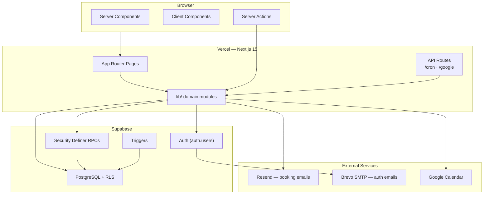

# NailsByGabs — Technical Architecture & Project Write-Up

This document is an in-depth technical overview of **NailsByGabs**, a production web application built for a solo GelX nail artist. It covers product decisions made during development, system architecture, implementation patterns, and the specific engineering challenges encountered feature by feature.

**Production URL:** [https://nailsbygabs.org](https://nailsbygabs.org)  
**Repository stack:** Next.js 15 · React 19 · TypeScript · Supabase · Vercel

**Last reviewed:** Codex 1 — 2026-10-27 16:23 EDT

---

## Table of Contents

1. [Executive Summary](#1-executive-summary)
2. [How This Project Evolved](#2-how-this-project-evolved)
3. [Owner-Driven Product Decisions](#3-owner-driven-product-decisions)
4. [Product Scope & Design Goals](#4-product-scope--design-goals)
5. [Technology Stack](#5-technology-stack)
6. [High-Level System Architecture](#6-high-level-system-architecture)
7. [Application Structure](#7-application-structure)
8. [Frontend Architecture](#8-frontend-architecture)
9. [Authentication & Authorization](#9-authentication--authorization)
10. [The Booking System](#10-the-booking-system)
11. [Database Design & Evolution](#11-database-design--evolution)
12. [Analytics Subsystem](#12-analytics-subsystem)
13. [Notifications & Scheduled Jobs](#13-notifications--scheduled-jobs)
14. [External Integrations](#14-external-integrations)
15. [Security Model](#15-security-model)
16. [Deployment & Operations](#16-deployment--operations)
17. [Technical Challenges by Feature](#17-technical-challenges-by-feature)
18. [Architectural Tradeoffs](#18-architectural-tradeoffs)
19. [What Is Intentionally Out of Scope](#19-what-is-intentionally-out-of-scope)
20. [Future Directions](#20-future-directions)

---

## 1. Executive Summary

NailsByGabs began as a premium marketing site with a Square booking embed and evolved into a **custom, auth-gated appointment platform** with owner analytics, Google Calendar sync, and automated client emails—without ever adding on-site payments.

The core architectural bet is **simplicity with strong boundaries**:

- **PostgreSQL + Row Level Security (RLS)** as the authoritative business rules engine.
- **Security definer RPCs** for atomic, race-safe booking mutations.
- **Next.js App Router** with Server Components and Server Actions for a mostly server-rendered experience.
- **Optional integrations** (Resend, Google Calendar) that degrade gracefully when credentials are missing.

The site reflects a real small-business constraint: NailsByGabs operates without payment processing on the website. Clients book authenticated time slots; payment happens offline. That single decision eliminated Square, Stripe, deposits, and checkout flows—and shaped every layer of the stack.

---

## 2. How This Project Evolved

Understanding the build order matters because later features were layered onto live booking data, not greenfield schema.

| Phase | What shipped | Trigger |
|-------|--------------|---------|
| **1 — Marketing shell** | Portfolio, services, about, collapsible sidebar, pastel/gold aesthetic | Initial project spec |
| **2 — Square embed** | Booking page with iframe placeholder | Original booking approach |
| **3 — Custom booking** | Supabase auth, slot RPCs, owner/client calendar | Owner rejected Square as overkill; wanted login + calendar only, no payments |
| **4 — Owner tooling** | Manual pre-booked slots, Google Calendar sync, Resend notifications | Real salon workflow needs |
| **5 — Portfolio intelligence** | Filename-based tag sorting (Aura, 3D, Design…), display title parsing | Owner renamed photos for categorization |
| **6 — Production hardening** | Eastern timezone fix, domain (nailsbygabs.org), email verification via Brevo SMTP | Live client usage exposed bugs |
| **7 — Business intelligence** | Analytics dashboard, event log, backfill, timeframe filters, chart iterations | Owner wanted visibility into bookings/completions/revenue |
| **8 — UX refinement** | Desktop navigation iterations, analytics hover tooltips, chart copy cleanup | Portfolio-first layout vs navigation discoverability |
| **9 — Client retention** | 48-hour email reminders via daily cron | Chosen as highest-impact next feature without payments |
| **10 — Security hardening** | Migration 013 (clients read only their own data), owner phone moved to env var, all `.env*` files git-ignored | Review found clients could read every profile, booking name/note, and the owner email through the Supabase API |
| **11 — Overhaul prep** | `AGENTS.md` shared change log, `CLAUDE.md`, dark-mode variant removed, header shadow made theme-aware | Start of a large visual and content overhaul with multiple agents |
| **12 — Visual and portfolio overhaul** | Sticky desktop top nav, 40 new sets, WebP image pipeline, seasonal Halloween theme, owner Photos tool, carousel/lightbox performance work | Owner content delivery and mobile performance review |

Each phase added complexity only where the owner confirmed it was needed—Square was removed rather than extended; analytics was backfilled rather than starting from zero; reminders were email-only rather than SMS.

---

## 3. Owner-Driven Product Decisions

This section documents decisions made explicitly through development prompts—not assumptions baked in by default.

### 3.1 No Square, no payments, custom calendar instead

**Decision:** Remove the Square iframe entirely. Build a lightweight slot calendar where logged-in clients book open times and the owner adds/removes slots.

**Rationale (owner words):** Square was "too much" for the use case. The business is under-the-table; the website must not process payment.

**Architectural consequence:** Supabase auth + Postgres RPCs replaced a third-party booking SaaS. Every later feature (analytics sources, reminders, Google sync) builds on `appointment_slots` rows, not Square webhooks.

### 3.2 Manual pre-booked appointments

**Decision:** The owner can create slots that are already taken, with a **name parameter**, without a client account attached.

**Architectural consequence:** `booked_name` column alongside `booked_by`. Manual slots appear on the owner calendar but not on any client's "my booking" state. Analytics logs them as `booking_source: manual`. Reminder and confirmation emails skip them (no client email exists).

### 3.3 Dual locations: Webster and Binghamton

**Decision:** Appointments are tagged by location. Binghamton bookings require a client acknowledgement ("I attend Binghamton University").

**Architectural consequence:** `location` column, location-colored calendar slots, analytics location splits, and a config-driven acknowledgement dialog (`booking-acknowledgements.ts`) that gates the book action client-side.

### 3.4 Default one-hour appointments

**Decision:** When the owner sets a start time, end time auto-fills to one hour later—still manually overridable.

**Architectural consequence:** Client-side default in the booking dialog; stored as explicit `start_at`/`end_at` in the database.

### 3.5 Eastern Time everywhere

**Decision:** All appointment times display and input in Rochester/Eastern time, regardless of client device timezone.

**Architectural consequence:** `business-timezone.ts` with iterative DST correction. Triggered by a real bug: 4:30 PM Rochester appeared as 12:30 PM after treating `datetime-local` as UTC.

### 3.6 Portfolio tag system and owner overrides

**Decision:** Sort tabs: Seasonal, Aura, Blooming, Design, Fruit, Ombre, French, Chrome, Cat Eye, 3D. Older photos infer tags from filenames; camera-named sets use explicit metadata. The owner can override tags, titles, carousel inclusion, and order from `/photos`. Special rules:

- `W` in a filename means "with" (multi-tag), e.g. legacy filename `3DWFun` → **"3D & Design"**
- Three or more tags use comma separation: **"3D, Design, Blooming"**
- Strip numeric suffixes from display (`Fun3` → `Design`) but **preserve the 3 in "3D"**
- Lightbox shows descriptors only, never raw filenames

**Architectural consequence:** `portfolio.ts` provides the static registry and defaults; `portfolio_photos` stores owner overrides merged by `getManagedPhotos()`. Photos must still be registered in code to appear (see [Section 17.4](#174-portfolio-static-registry-vs-new-uploads)).

### 3.7 Branding: GelX Nails

**Decision:** Replace "Premium Nail Artistry" with **"GelX Nails"** in site metadata and navigation branding.

**Logo state (2026-10-27):** The owner supplied a pink `NAILS / By Gabs` PNG for current logo use. The untouched source is preserved under git-ignored `image-originals/branding/source/`. `public/branding/NailsByGabsLogo.png` is a cropped, metadata-free palette PNG used by the generated Open Graph/Twitter card; `NailsByGabsIcon.png` is the metadata-free 512px favicon, shortcut icon, and Apple touch icon. The main wordmark was tested as WebP, but Next's `ImageResponse` closed the social-image request when embedding the WebP data URI, so the compatible optimized PNG is retained. The desktop top-left navigation remains the text `NailsByGabs` wordmark at the owner's follow-up request.

### 3.8 Analytics requirements

**Decision:** Owner-only `/analytics` dashboard with:

- Profile counters and append-only booking event log
- Estimated revenue at **$39 per completed appointment** (configurable in DB)
- Completion after a **24-hour grace period** (not immediately at `end_at`)
- **Keep all history**—no auto-delete of completed records
- Splits by location and booking source (platform vs manual)
- Timeframe filter: **1 month, 6 months, 1 year, Entirety**
- Trend charts must show **empty periods as zero**, not omit them
- 1-month view: **daily smooth line chart**; longer views: monthly bars
- Y-axis: integers only (0, 1, 2…)
- X-axis: 1st of month, mid-month, last day—**without** a "· Today" suffix
- No explanatory copy about "days with zero completions"
- **1-month hover tooltips:** cursor-following popup with date and appointment count

**Architectural consequence:** Migrations 009–011, custom SVG chart component, `buildTrendPoints()` zero-fill logic, and a service-role analytics query path.

### 3.9 Desktop navigation: pinned top tab bar

**Decision (iterative):** The desktop navigation went through several sidebar forms before the owner chose a single always-visible top bar:

1. Clickable peek tab
2. Full-height hover strip
3. Top chevron hover tab
4. Tall labeled `MENU` tab
5. Final form: a **sticky top tab bar** with the brand, labeled public tabs, owner tabs after a divider, social links, and sign in/out

**Architectural consequence:** `DesktopNav` lives in the root layout so it stays pinned and does not re-animate between routes. The sidebar components and related CSS were deleted. Mobile keeps its pinned pill bottom navigation.

### 3.10 48-hour appointment reminders

**Decision:** Email clients **48 hours before** their appointment. Chosen over payments, reviews, or a client portal as the next highest-impact feature.

**Architectural consequence:** Migration 012 (`reminder_48h_sent_at`), `appointment-reminders.ts`, extension of the daily cron job. Manual bookings excluded.

### 3.11 Email strategy

**Decision evolution:**

- Supabase built-in email hit sending limits → temporarily disabled confirmation, then **Brevo SMTP** for Supabase auth emails
- **Resend** for booking notifications (owner alerts, client confirmation, reminders)—kept separate from Gabs's personal inbox
- Custom domain **nailsbygabs.org** via Cloudflare for production URLs and auth redirects

---

## 4. Product Scope & Design Goals

### Public-facing features

| Feature | Route | Description |
|---------|-------|-------------|
| Portfolio | `/` | Tag-filtered nail art gallery: short intro + Book button (no hero), featured carousel, masonry grid, lightbox |
| Services & Pricing | `/services` | DB-backed GelX menu; owner edits prices/notes |
| About | `/about` | Bio, contact, social links |
| Book Appointment | `/book` | Auth-gated calendar |

### Owner-only features

| Feature | Route | Description |
|---------|-------|-------------|
| Analytics | `/analytics` | KPIs, revenue estimates, splits, trend charts |
| Clients | `/clients` | Registered clients, verification status, auth helpers |
| Appearance | `/settings` | Live theme switching (cherry-studio, pearl, flower, seasonal halloween with scheduled switch-back) |
| Photos | `/photos` | Review/confirm gallery tags, edit titles, pick carousel photos, reorder (migrations 015–016) |
| Calendar admin | `/book` | Slot CRUD, Google Calendar connect, manual bookings |

### Explicit non-goals (confirmed, not deferred by accident)

- On-site payments or deposits
- Square or any booking SaaS embed
- Multi-staff scheduling
- Admin-side portfolio upload CMS

---

## 5. Technology Stack

| Layer | Choice | Rationale |
|-------|--------|-----------|
| Framework | **Next.js 15** (App Router) | Server Components, Server Actions, Vercel-native |
| UI | **React 19** + **Tailwind CSS v4** | CSS-variable theming, responsive layout |
| Components | **Radix UI** primitives | Accessible dialogs and form controls |
| Language | **TypeScript** (strict) | Server/client boundary safety |
| Database & Auth | **Supabase** | Postgres, RLS, triggers, RPCs, auth |
| Email (transactional) | **Resend** | Booking lifecycle emails |
| Email (auth) | **Brevo SMTP** via Supabase | Verification/reset emails on custom flow |
| Calendar sync | **Google Calendar API** | OAuth offline refresh tokens |
| Hosting | **Vercel** | Deploys, cron, env vars |
| Domain | **Cloudflare** | nailsbygabs.org DNS |

**Notable absence:** No ORM. Schema lives in version-controlled SQL migrations applied manually in Supabase.

---

## 6. High-Level System Architecture



### Request flow patterns

**Server-rendered read:** Middleware refreshes session → Server Component queries with RLS → HTML + hydrated client islands.

**Mutation:** Server Action verifies role → RPC or owner table write → Google sync + Resend (non-blocking) → `revalidatePath()`.

**Cron:** Bearer `CRON_SECRET` → service role → `mark_completed_appointments()` + `sendDueAppointmentReminders()`.

---

## 7. Application Structure

```
NailsByGabs/
├── AGENTS.md                        # Shared agent change log + orientation (read first)
├── CLAUDE.md                        # Points Claude Code sessions at AGENTS.md
├── .github/workflows/ci.yml         # Lint, typecheck, build, audit on push/PR
├── scripts/optimize-images.mjs      # Photo resize/WebP/metadata-strip pipeline
├── docs/                            # This document
├── public/
│   ├── portfolio/                   # Gallery WebP images (code-registered list in src/lib/portfolio.ts)
│   ├── effects/                     # Seasonal theme assets (pumpkins.svg)
│   ├── about/                       # Headshot
│   └── branding/                    # Logo source, share wordmark, favicon/app icon
├── src/
│   ├── app/                         # Routes, layouts, actions, API
│   ├── components/                  # ui/, booking/, analytics/, effects/, portfolio/, …
│   ├── lib/                         # Domain logic, Supabase clients
│   ├── middleware.ts                # Supabase session refresh only (no route guards)
│   └── types/
├── supabase/
│   ├── migrations/                  # 001–016 SQL (manual apply in production)
│   ├── config.toml                  # Local Supabase (CLI) settings
│   ├── data/                        # Idempotent production data imports
│   └── email-templates/             # Supabase auth email HTML (pasted into dashboard)
├── vercel.json                      # Daily cron
└── .env.example
```

---

## 8. Frontend Architecture

### Layout shell

`src/app/layout.tsx` loads session + theme in parallel, sets `data-theme` on `<html>`, and renders `DesktopNav`, seasonal effect layers, the page scroll region, and `MobileBottomNav`. On mobile, only `.app-scroll-region` scrolls so the bottom navigation remains pinned in in-app browsers; desktop uses normal window scrolling.

### Responsive navigation (owner-refined)

| Viewport | Navigation |
|----------|------------|
| Desktop | One **top bar pinned while scrolling** (`components/desktop-nav.tsx`, rendered in the root layout): NailsByGabs name, labeled page tabs (active = pill), divider + owner tabs, social icons, Sign in/out. No sidebar |
| Mobile | Pinned pill bottom nav with sliding indicator |

The desktop pattern went through **five iterations**: clickable peek tab → full-height hover strip → top chevron tab → tall `MENU` tab → pinned top bar. The final version keeps every destination visible without covering portfolio content.

### Theming

Owner-selectable themes in `/settings`, stored in `app_config.active_theme`, applied via CSS variables in `globals.css`. Location-specific slot colors on the booking calendar inherit theme tokens.

**Seasonal themes (migration 014).** `halloween` is a dark seasonal theme with:
- a faint jack-o'-lantern pattern (`public/effects/pumpkins.svg`) drifting diagonally behind all content, plus drifting fog in front (bats were removed 2026-10-27)
- the Creepster font on page titles (no glow) and a softened orange (`#ef8a45`) with the slime-green accent kept vivid

Selecting a seasonal theme opens a popup to schedule an automatic switch back. The default is the next Nov 1 at 12:00 AM Eastern, and the switch-back theme is the owner's current everyday theme.

How it works:
- **Writing:** `set_site_theme(p_theme, p_revert_at, p_revert_to)` (security definer, owner-only) validates and stores the theme and the `theme_revert_at` / `theme_revert_to` keys atomically.
- **Switching back:** there is no cron. `getThemeState()` notices a due switch-back while rendering and calls `apply_due_theme_revert()`, which is safe for anonymous callers because it only acts once the time has passed. The switch therefore happens on the first page view after the scheduled time.

- **Theme ids:** `cherry-studio` (default), `pearl`, `flower`, and seasonal `halloween` are defined in `src/lib/themes.ts`. Each one has a `[data-theme="…"]` token block in `globals.css`, and those tokens are mapped into Tailwind through `@theme inline`.
- **Visitor read path:** the public reads only the `active_theme` key, via the "Anyone can read active theme" RLS policy. All other `app_config` keys are owner-only since migration 013.
- **No OS-driven dark mode.** The unused Tailwind `dark` variant and `dark:` classes were removed on 2026-10-24. Halloween is intentionally dark only when the owner activates that site theme.
- **Every color comes from theme tokens; nothing is hardcoded.** For example, the mobile header shadow (`.site-header-shadow`) is derived from `--accent`.

### Analytics chart UI (owner-specified behavior)

| Timeframe | Chart type | Interaction |
|-----------|------------|-------------|
| 1 month | Daily smooth SVG line, zero-filled | Hover tooltip under cursor with date + count |
| 6m / 1y / all | Monthly bar chart, zero-filled | Static bars with count labels |

Chart engineering lives in `analytics-trend-chart.tsx` and `analytics-trend.ts`. Timeframe selection uses `?range=1m|6m|1y|all`.

---

## 9. Authentication & Authorization

### Three Supabase clients

| Client | Usage |
|--------|-------|
| Browser (anon) | Minimal client usage |
| Server (anon + cookies) | RLS-bound reads/writes |
| Admin (service role) | Cron, analytics, Google sync, reminders, client list |

### Owner assignment

Signup trigger compares email to `app_config.owner_email` → assigns `owner` or `client` role once. Role is immutable via RLS.

### Read model (since migration 013)

| Table / function | Client (authenticated) can read | Owner can read |
|------------------|----------------------------------|----------------|
| `profiles` | Own row only | All rows (via `is_owner()`) |
| `appointment_slots` | Open slots + own bookings | All rows |
| `get_taken_slots()` RPC | Other clients' upcoming bookings as **id, times, location only** (no name/notes) | — |
| `app_config` | `active_theme`, `theme_revert_at`, `theme_revert_to` only (public policy, migration 014) | All keys |
| `portfolio_photos` | All rows (public gallery metadata) | All rows; insert/update/delete (migration 015) |
| `booking_events` | Nothing | All rows |

`is_owner()` is a security definer helper so the `profiles` policy can check the caller's role without recursing into itself. Internal functions (`log_booking_event`, `mark_completed_appointments`, `analytics_tracking_started_at`) are no longer executable through the API. `mark_completed_appointments` is granted only to `service_role`.

### Email verification flow

After signup, users see a message to check email and verify before signing in. Auth emails go through Brevo SMTP configured in Supabase—not Resend.

### Authorization style

There are no middleware route guards. Every owner-only entry point calls a helper from `src/lib/auth.ts`:

- `requireOwner(redirectTo = "/")` in owner pages and route handlers. It redirects non-owners.
- `getOwnerSession()` in Server Actions. It returns `null` for non-owners, so the action can return its own error message.

`getSessionProfile()` is wrapped in React `cache()`, so the layout, header, page, and helpers share one Supabase auth lookup per request.

---

## 10. The Booking System

### Core model: `appointment_slots`

Key columns: `start_at`, `end_at`, `status`, `booked_by`, `booked_name`, `location`, `notes`, `google_event_id`, `booking_updated_at`, `completed_at`, `reminder_48h_sent_at`.

### RPCs (security definer)

| RPC | Purpose |
|-----|---------|
| `book_appointment_slot` | Client books open slot; logs analytics; resets reminder flag |
| `cancel_my_booking` | Client cancels; logs event; clears slot |
| `release_appointment_slot` | Owner releases booking |
| `get_taken_slots` | Read-only: other clients' upcoming bookings as times only (migration 013) |

Clients never UPDATE slots directly—RPCs enforce atomicity and race safety.

**Client calendar data path:** `/book` merges the client's RLS-visible slots (open slots and their own bookings) with `get_taken_slots()` rows rendered as "Taken". Before migration 013, the page sent every booking's name and notes to the browser.

### Post-booking side effects (never block the booking)

1. Google Calendar sync (service role)
2. Owner Resend email
3. Client confirmation Resend email

Cancellation captures notification details **before** the RPC clears `booked_by`.

### Google Calendar

Owner OAuth stores refresh token. Every slot mutation syncs create/update/delete to Google. Required service role when a **client** triggers sync (owner token not readable under client RLS session).

---

## 11. Database Design & Evolution

Migrations **001–016** are applied manually in Supabase SQL Editor—no CI migration runner. Locally, `npx supabase start` applies them automatically. Production migrations 014–016 and the 40-row photo metadata export were confirmed applied without error on 2026-10-27.

| # | Owner-relevant change |
|---|----------------------|
| 001 | Core slots, profiles, booking RPCs |
| 005 | Manual bookings (`booked_name`) |
| 007 | Webster / Binghamton locations |
| 009 | Analytics event log, completion RPC, 24h grace |
| 010 | **Keep history forever** (removed purge) |
| 011 | **Backfill** analytics from existing slots |
| 012 | 48h reminder tracking |
| 013 | **Restrict client reads**: own profile/bookings only, `get_taken_slots()`, owner-only `app_config`, revoke internal RPCs |
| 014 | **Seasonal themes**: `halloween` allowed, `is_site_theme()`, `set_site_theme()`, `apply_due_theme_revert()`, public read of the revert schedule |
| 015 | **Portfolio photos**: owner-editable gallery metadata (tags, title, featured, sort order, needs_review); rows only for edited photos |
| 016 | **Rename gallery tag**: replaces `Fun` with `Design` in saved metadata and updates the tag constraint |

The production photo import is `supabase/data/portfolio_photos_2026-10-27.sql`. It idempotently upserts the owner's 40 reviewed rows after migrations 015 and 016.

### Analytics event types

`booked` · `cancelled` · `released` · `completed` · `deleted` — with `platform` or `manual` source.

---

## 12. Analytics Subsystem

Built because the owner wanted business visibility without Google Analytics or spreadsheets.

### Owner requirements → implementation mapping

| Requirement | Implementation |
|-------------|----------------|
| $39 estimated revenue | `default_appointment_value_cents = 3900` in `app_config` |
| 24h grace before completion | `mark_completed_appointments()` checks `booking_updated_at` |
| Never delete history | Migration 010 dropped purge function |
| Meaningful day-one data | Migration 011 backfill from existing slots |
| Timeframe buttons | `analytics-timeframe-bar.tsx` + `?range=` param |
| Honest charts | Zero-filled buckets in `buildTrendPoints()` |
| Daily line for 1 month | Custom SVG in `DailyLineChart` |
| Integer Y-axis | `buildYTicks()` 0..max by 1 |
| Clean X-axis labels | 1st, mid-month, last day—no "Today" suffix |
| No zero-completion disclaimer text | Removed from `analytics-dashboard.tsx` |
| Hover scrub (1m only) | Pointer tracking + tooltip under cursor |

### Service role requirement

`booking_events` RLS is owner-read-only. The analytics snapshot uses the admin client to aggregate across all clients and events.

---

## 13. Notifications & Scheduled Jobs

### Email channels (two providers by design)

| Channel | Provider | Emails |
|---------|----------|--------|
| Supabase Auth | Brevo SMTP | Signup verification, password reset |
| Booking lifecycle | Resend | Owner book/cancel alerts, client confirmation, 48h reminder |

Keeping booking emails on Resend means Gabs doesn't get owner notifications from her own personal address to herself—a preference stated during email setup.

### Resend email types

| Email | When |
|-------|------|
| Owner: new booking | After client books |
| Client: confirmation | After client books |
| Owner: cancellation | After client cancels |
| Client: "Your appointment is cancelled" | After client cancels |
| Client: "Gabs dropped your appointment" | Owner releases or deletes an upcoming platform booking (optional note from Gabs) |
| Client: "Gabs updated your appointment" | Owner changes the **time or location** of an upcoming platform booking (optional note; shows the previous details). Changing only Gabs's calendar label sends nothing |
| Client: 48h reminder | Daily cron. Reset when the owner changes the time, so the new time gets its own reminder |

All Resend calls are wrapped in try/catch and **never throw**.

**Rules for emails Gabs's actions trigger:**
- Manual bookings (no `booked_by`) and appointments that have already ended never email anyone.
- The client's email comes from `auth.users` via the service role (`readUpcomingClientBooking()`). It is read *before* the release, delete, or edit, because those clear or change the row.
- On `/book`, Release and Delete on such a booking open a confirm popup with an optional "Message to client" (max 500 characters). The edit dialog shows the same optional field.

### Email styling

All four Resend emails share one layout, `buildEmailHtml` in `notifications.ts`, colored from the **active site theme**.

- **Colors:** each `THEME_CATALOG` entry in `themes.ts` has an `email` palette of hex values that mirror the `globals.css` tokens, because email clients cannot read CSS variables. Any change to theme colors must update both places.
- **Escaping:** every interpolated value is HTML-escaped (`escapeHtml`). Client names and notes are user input.
- **Auth emails are separate:** the Supabase auth emails (`supabase/email-templates/`) are static HTML pasted into the Supabase dashboard and do not follow the active theme.

### Cron (Vercel Hobby constraint)

**Schedule:** once daily at 13:00 UTC (~9 AM Eastern)

**Tasks:** completion marking + reminder sending

**Reminder window:** appointments 24–60 hours away (targets ~48h; exact timing impossible on daily cron)

**Dedup:** `reminder_48h_sent_at` on slot row

---

## 14. External Integrations

### Google OAuth — setup pain points (real deployment)

The owner hit several Google Cloud Console issues during setup:

- Locating OAuth consent screen in updated Google UI
- **Invalid Origin** error: callback URL placed in wrong field (redirect URI vs authorized JavaScript origin)
- Finding client secret after creating OAuth client
- **403 verification** error until app was in testing mode with test users added

Once resolved, sync works bidirectionally from the website: book/cancel/edit/delete all update Google events.

### Cloudflare + nailsbygabs.org

Custom domain required updating `NEXT_PUBLIC_SITE_URL`, Supabase redirect URLs, Google OAuth redirect URI, and Vercel domain config. Permanent redirect from `nails-by-gabs.vercel.app` in `next.config.ts`.

### Resend production gotcha

`RESEND_FROM_EMAIL` pasted into Vercel with accidental **newline characters** broke the from-address parser. Code now sanitizes env values and falls back to Resend dev domain.

---

## 15. Security Model

### Controls in place

- RLS on all tables. Since migration 013, clients read only their own profile and bookings (see [Section 9](#9-authentication--authorization)).
- Security definer RPCs for booking, with internal functions revoked from API roles.
- `server-only` on privileged modules (`lib/supabase/admin.ts`, `lib/auth.ts`, `lib/clients.ts`, …).
- Every owner page and Server Action checks `profile.role === "owner"` itself; middleware does not guard routes.
- Cron endpoint requires `Authorization: Bearer <CRON_SECRET>`.
- Google OAuth callback requires an owner session, and `state` must equal the owner's user ID.
- The service role key is never exposed to the browser.
- No personal contact data in source: the owner phone comes from `NEXT_PUBLIC_OWNER_PHONE`, and all `.env*` files are git-ignored.

### Open security gaps (review of 2026-10-24)

The review found these gaps; they are **not yet fixed**. Track fixes in `AGENTS.md`.

| # | Severity | Issue | Recommended fix |
|---|----------|-------|-----------------|
| S1 | **Critical** | `npm audit` reports 5 advisories (1 critical, 4 high): `next` 15.5.19 (Server Actions DoS, cache confusion), `sharp` (libvips/libheif), `postcss`, `nanoid`, `source-map-js` | `npm audit fix`. All fixes stay within current majors (e.g. `next` 15.5.28) |
| S2 | High → **partly fixed** | **HTML injection in booking emails.** Escaping was added on 2026-10-24 (`escapeHtml` in `notifications.ts`). Still open: `notes` and `full_name` have no length limit | Cap lengths in the `book_appointment_slot` RPC / signup trigger and in the Server Actions |
| S3 | Medium | **No security headers.** `next.config.ts` sets no CSP, HSTS, `X-Frame-Options`/`frame-ancestors`, `Referrer-Policy`, or `Permissions-Policy` | Add `headers()` in `next.config.ts` |
| S4 | Medium | **Google OAuth `state` is the owner's user ID**, which is predictable rather than a per-request nonce. A login-CSRF could link an attacker's Google account and sync client names to it | Random nonce stored in an httpOnly cookie and compared on callback |
| S5 | Medium | **Weak auth policy and no bot protection.** Minimum password length is 6; signup, login, and reset have no CAPTCHA | Raise to 8+ in Supabase and `updatePassword`, enable leaked-password protection, add Cloudflare Turnstile through Supabase Auth CAPTCHA |
| S6 | Low | **Owner client actions trust form input.** `sendClientPasswordReset` and `sendClientVerificationEmail` take the email from the form instead of looking it up by `clientId` | Resolve the email server-side through `auth.admin.getUserById` |
| S7 | Low | **Raw error messages reach the UI.** Server Actions return Supabase `error.message` directly to the client | Map to friendly messages and log details server-side |
| S8 | Low | **Non-constant-time cron secret comparison** | Use `crypto.timingSafeEqual` |
| S9 | Low | **Google refresh token stored in plaintext** in `owner_integrations` (RLS owner-only) | Supabase Vault or app-level encryption |

---

## 16. Deployment & Operations

### Operational checklist

1. Keep production migrations synchronized manually. Migrations 001–016 are applied; 014–016 and `supabase/data/portfolio_photos_2026-10-27.sql` were confirmed successful on 2026-10-27. For a fresh environment, run migrations in order, then the photo export after 016. After 013, check the `pg_policies` query at the end of that file: any leftover `using (true)` read policy created in the dashboard undoes the restriction
2. Set real `owner_email` in `app_config`
3. Configure Vercel env vars (see `.env.example`)
4. Connect Google Calendar from owner account on `/book`
5. Verify daily cron after 13:00 UTC

### Environment variables (critical)

`NEXT_PUBLIC_SUPABASE_*`, `SUPABASE_SERVICE_ROLE_KEY`, `CRON_SECRET`, `RESEND_*`, `GOOGLE_*`, `NEXT_PUBLIC_SITE_URL`, `NEXT_PUBLIC_OWNER_PHONE` (optional; About page hides the phone link when unset)

### Verification

There is no automated test suite. Verify changes with `npm run lint` (ESLint CLI, `eslint.config.mjs`), `npm run typecheck`, and `npm run build`, then check manually in `npm run dev`:

- **Roles:** signed out, client, owner
- **Themes:** all four, including Halloween effects and scheduled switch-back
- **Widths:** mobile and desktop
- **Browsers:** ideally Instagram's in-app browser, which is where most visitors arrive

`npm run build` requires `NEXT_PUBLIC_SUPABASE_URL` and `NEXT_PUBLIC_SUPABASE_ANON_KEY`. Placeholder values are enough, because every page renders per request.

GitHub Actions (`.github/workflows/ci.yml`) runs lint, typecheck, a placeholder-env build, and `npm audit` on pushes to `main` and on PRs. The audit step is non-blocking until S1 is fixed.

---

## 17. Technical Challenges by Feature

This section ties **specific features** to **specific problems** encountered during this project—not generic web dev advice.

### 17.1 Rejecting Square for custom booking

**Problem:** Square iframe was live but mismatched requirements—payments, complexity, and cost the owner didn't want.

**Challenge:** Replacing it meant building auth, concurrency-safe booking, owner CRUD, and a calendar UI from scratch.

**Solution:** Supabase slot model + RPCs + week/month calendar grid. Simpler domain, full control, no payment PCI scope.

---

### 17.2 Rochester timezone display bug

**Problem:** Owner entered 4:30 PM; site and Google showed 12:30 PM.

**Root cause:** `datetime-local` values interpreted as UTC instead of Eastern wall time.

**Solution:** `parseBusinessDateTimeLocal()` with iterative DST offset correction; all display via `America/New_York`.

**Lesson:** Always treat salon time as a **business timezone**, not browser locale or raw UTC.

---

### 17.3 Google Calendar sync across users

**Problem:** Client books → must update **owner's** Google Calendar, but RLS blocks reading owner's `owner_integrations` row from client session.

**Solution:** `syncGoogleForSlot()` always uses service role to fetch refresh token. Booking succeeds even if service role or Google creds missing (logged, not thrown).

---

### 17.4 Portfolio static registry vs new uploads

**Problem:** Owner added photos and pushed to Git; **deployment didn't show them**.

**Root cause:** Portfolio reads from a **code-defined file list** in `portfolio.ts`, not dynamic directory scanning. Untracked or unlisted files don't appear.

**Solution:** Add filenames to `PORTFOLIO_FILE_NAMES` (URL-encoded for spaces).

**Current state (2026-10-27):** the registry has two kinds of entries. `LABELED_SETS` has explicit defaults and crop points for camera names like `IMG_1234`; `PORTFOLIO_FILE_NAMES` holds the older filename-tagged photos. The owner's review of the 40 new sets was exported and applied to production, so saved `portfolio_photos` rows now override those defaults. A `Seasonal` filter tab handles holiday sets. The photoshoot images are intentionally unused.

**Lesson:** Static asset galleries need an explicit registry step—upload alone isn't enough.

**Image weight:** resolved on 2026-10-27. All 81 gallery photos are WebP produced by the optimizer: 238 MB of originals became 9.4 MB. Originals live in the git-ignored `image-originals/` folder (`portfolio/`, `about/`, `branding/`, `photoshoot/`, `retired/`, `review/`). The old JPEGs remain in git history.

**About portrait (deliberate exception to the 2000px pipeline).** The source is `image-originals/about/NailsByGabsAbout.JPEG` (6000×4000, sRGB). It is published at **full resolution** as `public/about/NailsByGabsAbout.webp`: q92, metadata stripped, 2.3 MB. `next/image` serves each visitor a resized copy, so the full file is only the optimizer's source.

The 2000px version blurred because the About card is a crop: `object-cover` must fill the card's height, so the image needs more width than the card itself. The fix is a 4:3 card (`className="aspect-[4/3]"`, `imagePosition="52% 50%"`) with `sizes="(min-width: 1024px) 55vw, 105vw"` and `quality={90}`, set through `ProfileCard`'s `sizes`/`quality` props. Measured: a 1920w file is picked at 0.78× (desktop @2x) and 0.63× (iPhone @3x) device px per image px, so nothing is upscaled. The cropped logo was reduced from 281 KB to a metadata-free 90 KB palette PNG; the square compatibility icon is 67 KB and metadata-free.

Pipeline: `npm run images:optimize -- image-originals/portfolio --out public/portfolio` (`scripts/optimize-images.mjs`). It applies EXIF rotation, resizes the long edge to 2000px, writes WebP at quality 80, and strips metadata, including any GPS location.

**Crop points:** each photo has an `object-position` in `focalByFileName`, set to the center of the nail art. Because the image point at Y% aligns with the container point at Y%, the nails stay in frame for square tiles, 4:5 cards, and the 16:10 lightbox alike.

---

### 17.5 Portfolio title parsing edge cases

**Problem:** Display logic stripped digits from tags, turning **"3D"** into **"D"**.

**Owner clarification:** Remove numeric suffixes from legacy filenames (`Fun3` → `Design`) but never remove the `3` from the `3D` token. Legacy filenames remain unchanged while their public tag/title uses `Design`.

**Solution:** Parser rules for `W` = "with", comma vs ampersand joining, and protected `3D` literal.

---

### 17.6 Supabase auth email limits

**Problem:** Supabase built-in email quota exhausted during account creation testing.

**Decision:** Temporarily disable email confirmation; later enable **Brevo SMTP** in Supabase dashboard.

**Challenge:** Two email systems now—Brevo for auth, Resend for booking—each with different DNS/deliverability concerns.

---

### 17.7 Vercel Hobby cron blocked hourly schedule

**Problem:** Original design used hourly cron for completion marking (and later reminders). **Vercel Hobby allows one cron per day.**

**Solution:**

- Single endpoint `/api/cron/appointment-lifecycle` runs daily at 13:00 UTC
- Completion uses 24h grace (already compatible with daily runs)
- Reminders use 24–60h window instead of exact T-minus-48h

**Documented escape hatch:** External cron (cron-job.org) or Vercel Pro for hourly precision.

---

### 17.8 Analytics on live data without empty dashboard

**Problem:** Analytics shipped after months of real bookings. Empty event log = useless dashboard.

**Solution:**

- Migration 011 backfills `booking_events` from historical slots
- Migration 010 removes auto-purge (owner wanted permanent history)
- Profile counters recomputed from backfill

**Challenge:** Backfill SQL is complex—must infer cancelled/released/completed states from slot row history accurately.

---

### 17.9 Misleading analytics charts

**Problem:** First charts omitted days/months with zero completions, making sparse periods look like data gaps or false trends.

**Owner feedback:** Wanted full timeframe visible; 1-month as daily line; integer Y-axis; specific X-axis labels; later removed "zero completions" helper text and "· Today" suffix.

**Solution:**

- `buildTrendPoints()` zero-fills all buckets in range
- Separate chart modes: SVG line (1m) vs bars (6m/1y/all)
- Responsive `ResizeObserver` width
- Pointer-tracking tooltip (1m only) with crosshair + dot

---

### 17.10 Desktop sidebar UX iteration

**Problem:** Portfolio site needs maximum content width; persistent sidebar competes with gallery. Hidden sidebar is undiscoverable. Click tabs feel intrusive.

**Owner prompts (in sequence):**

1. "Make hover sidebar more pronounced; remove click tab on desktop"
2. "Tab only towards top; bump out more; arrow pointing left"

**Evolution:**

| Version | Behavior | Owner reaction |
|---------|----------|----------------|
| Click peek tab + header toggle | Click to open | Too click-heavy |
| Full-height hover strip | Edge hover | Too aggressive visually |
| Top chevron hover tab | Hover below header, bump-out animation | Shipped (2026-08) |
| Tall labeled "MENU" tab | Hover or click; click-outside/Esc close | Replaced: felt big and overlapped content |
| **Top tab bar** (no sidebar) | Labeled tabs always visible, pinned on scroll, mirrors the mobile bottom bar | **Shipped (2026-10-27)** |

**Final implementation:** `DesktopNav` is rendered by the root layout and remains sticky at the top. It shares `PUBLIC_NAV` and `OWNER_NAV` with the mobile bar through `src/lib/nav.ts`. The old sidebar, hover tab, sheet, tooltip, separator, skeleton, and `use-mobile` files were deleted.

---

### 17.11 48-hour reminders with daily cron

**Problem:** Owner asked for 48h email reminders; cron runs once daily.

**Challenge:** Cannot guarantee email at exactly 48 hours before every appointment.

**Solution:**

- Query slots 24–60 hours out with `reminder_48h_sent_at IS NULL`
- Skip bookings <24h away (confirmation email enough)
- Skip manual bookings (no `booked_by` → no client email)
- Re-check slot still booked before sending (race with cancellation)
- Use service role + `auth.admin.getUserById()` for email (session client has no access in cron context)
- Mark sent only after Resend accepts

---

### 17.12 Email must never block booking

**Problem:** Resend failures (missing key, bad from address, rate limits) must not roll back a successful booking.

**Solution:** Notifications run after RPC success; all functions catch and log. Owner may need to check calendar if email silently failed.

---

### 17.13 Manual migrations in production

**Problem:** No automated migration pipeline. Owner/developer runs SQL manually in Supabase.

**Risk:** Schema drift between local assumptions and production.

**Mitigation:** Numbered migrations, idempotent patterns, full RPC replacements in later migrations (009/012 replace booking functions entirely), runbook in migration headers.

---

### 17.14 Over-broad client read access

**Problem:** The original RLS policies let any signed-in user read every profile, every slot (including other clients' names and notes), and `app_config`, which includes the owner's email. The `/book` page also sent all of that to the browser.

**Solution (migration 013):**

- Owner check moved into the security definer `is_owner()` helper so it can be used safely in policies on `profiles` itself.
- Clients can read only open slots and their own bookings.
- The new `get_taken_slots()` RPC returns other bookings as times only, so the calendar can still show "Taken".
- `app_config` is owner-only, apart from the public `active_theme` key.
- Internal RPCs are revoked from API roles.

**Lesson:** "Authenticated" is not a trust boundary on a site where anyone can sign up. Policies must be scoped to the row owner.

---

## 18. Architectural Tradeoffs

| Decision | Benefit | Cost |
|----------|---------|------|
| Custom booking over Square | No payments, full control, simpler domain | We build reminders, analytics, sync ourselves |
| No ORM | RLS-first SQL in repo | Manual types; migration discipline required |
| Daily cron on Hobby | Free tier | Approximate reminder timing |
| Static portfolio registry | Fast CDN, simple code | Deploy required to add photos |
| Persistent desktop top nav | Every destination is visible and pinned | Uses horizontal space on narrower desktops |
| Event-sourced analytics | Accurate history, splits | Service role required; backfill complexity |
| Two email providers | Right tool per job (auth vs transactional) | Two DNS/config surfaces |

---

## 19. What Is Intentionally Out of Scope

Confirmed with owner—not a backlog oversight:

- On-site payments
- Square / booking SaaS
- Client `/account` portal (discussed as future; not built)
- SMS reminders
- Gallery file uploads or a full binary-asset CMS (metadata editing exists at `/photos`)
- Reviews/testimonials module
- Multi-staff scheduling

---

## 20. Future Directions

Discussed in conversation as next steps **without payment**:

1. ~~48-hour appointment reminders~~ — **shipped**
2. Client "My Appointments" view
3. Service selection at booking time
4. SEO (sitemap, robots, JSON-LD)
5. ~~Client cancellation confirmation email~~ — **shipped**
6. Owner settings UI for notification email and revenue default
7. ~~Wire staged portfolio photos into registry and production metadata~~ — **shipped 2026-10-27**
8. Close the security gaps in [Section 15](#15-security-model) (S1–S9)
9. ~~Portfolio image optimization pipeline~~: **done 2026-10-27**
10. Loyalty membership and client-visible progress (rules still require owner answers; see `AGENTS.md`)
11. ~~Apply the supplied logo to browser icons and social share cards~~ — **shipped 2026-10-27**; desktop navigation intentionally remains text

### Architecture follow-ups (2026-10-24 review)

Resolved on 2026-10-24:
- Session lookups are now deduplicated with React `cache()`.
- `requireOwner()` and `getOwnerSession()` replace 14 repeated owner checks.
- Dead Square CSS and the placeholder files in `public/` are removed.
- Lint moved to the ESLint CLI.
- GitHub Actions CI is added.

Still open:
- **Every route is dynamic.** The root layout reads the session, so even the portfolio and services pages render per request. Moving the auth-dependent nav bits to a client island, or using partial prerendering once it is stable, would let the public pages be static and CDN-cached.
- **Copy is scattered.** Content lives in `lib/data.ts`, `lib/site-metadata.ts`, and inline page JSX. Gathering marketing copy into one module would make future content updates easier.

Resolved on 2026-10-27:
- Local Supabase now runs through the CLI and Docker with `supabase/config.toml`; `npx supabase start` applies the migrations and Mailpit captures local email.

---

## Appendix: Key File Reference

| Concern | Files |
|---------|-------|
| Layout & navigation | `src/app/layout.tsx`, `src/components/desktop-nav.tsx`, `src/components/mobile-bottom-nav.tsx`, `src/app/globals.css` |
| Booking | `src/app/book/actions.ts`, `src/components/booking/*` |
| Timezone | `src/lib/business-timezone.ts`, `src/lib/dates.ts` |
| Portfolio parsing | `src/lib/portfolio.ts` |
| Analytics | `src/lib/analytics.ts`, `src/lib/analytics-trend.ts`, `src/components/analytics/*` |
| Reminders | `src/lib/appointment-reminders.ts`, `supabase/migrations/012_appointment_reminders.sql` |
| Cron | `vercel.json`, `src/app/api/cron/appointment-lifecycle/route.ts` |
| Notifications | `src/lib/notifications.ts` |
| Google sync | `src/lib/google-calendar.ts`, `src/app/api/google/*` |
| Migrations | `supabase/migrations/001` … `016` |
| Navigation | `src/lib/nav.ts`, `src/components/desktop-nav.tsx`, `src/components/mobile-bottom-nav.tsx` |
| Gallery data & editor | `src/lib/portfolio.ts` (defaults), `src/lib/portfolio-photos.ts` (DB merge), `src/app/photos/*`, `src/components/photos/photo-manager.tsx` |
| Seasonal theme | `src/lib/theme.ts`, `src/app/settings/actions.ts`, `src/components/settings/theme-picker.tsx`, `src/components/effects/halloween.tsx`, migration 014 |
| RLS read model | `supabase/migrations/013_restrict_client_reads.sql`, `src/app/book/page.tsx` |
| Theming | `src/app/globals.css`, `src/lib/themes.ts`, `src/lib/theme.ts`, `src/components/settings/theme-picker.tsx` |
| Branding & share images | `public/branding/`, `src/app/layout.tsx`, `src/app/opengraph-image.tsx`, `src/app/twitter-image.tsx` |
| Agent change log | `AGENTS.md` |

---

## Appendix: Commit Arc (feature milestones)

| Commit theme | Owner-visible change |
|--------------|---------------------|
| Analytics system + cron | Dashboard, completion marking |
| Timeframe filter | 1m / 6m / 1y / Entirety buttons |
| Chart zero-fill + daily line | Honest 1-month trend |
| Chart axes & responsive sizing | Readable Y/X axes |
| Remove "Today" + zero-copy | Cleaner chart labels |
| Hover-only sidebar | Historical navigation iteration |
| Top chevron hover tab | Historical navigation iteration |
| Sticky desktop top bar | Final desktop navigation UX |
| Owner Photos tool | Review tags/titles, carousel picks, ordering |
| Seasonal Halloween theme | Scheduled switch-back, pumpkins, fog |
| Analytics hover tooltips | 1m scrub with date + count |
| 48h reminders | Client email ~2 days before |
| Owner phone to env var | Phone no longer stored in source |
| Restrict client reads (013) | Clients see only their own data |

---

*This document reflects the NailsByGabs codebase through migration 016, the production photo metadata import, and the optimized 2026-10-27 branding/About assets (reviewed by Codex 1 at 16:23 EDT). Per-change history lives in `AGENTS.md`.*
